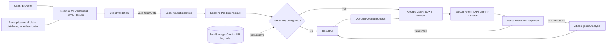
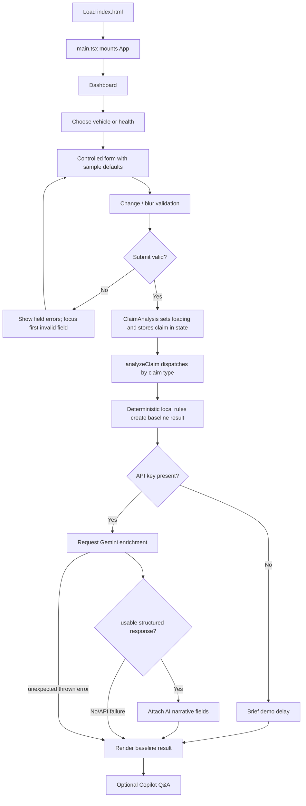
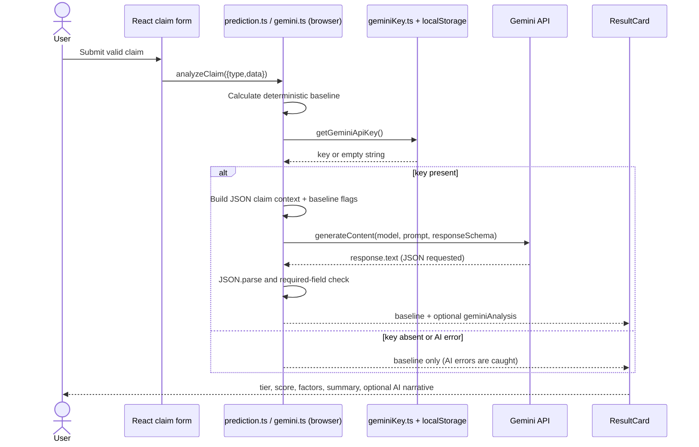
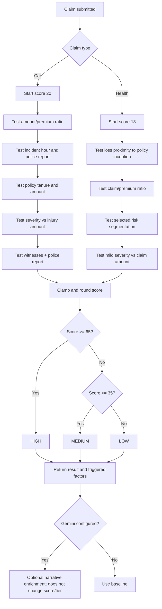
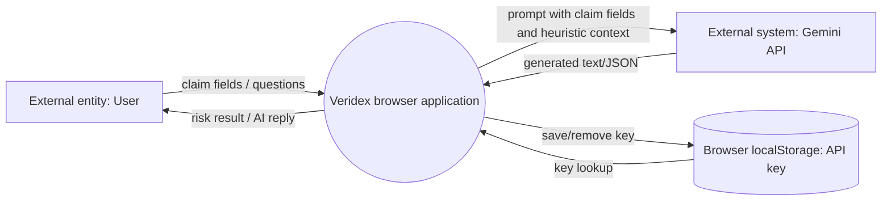
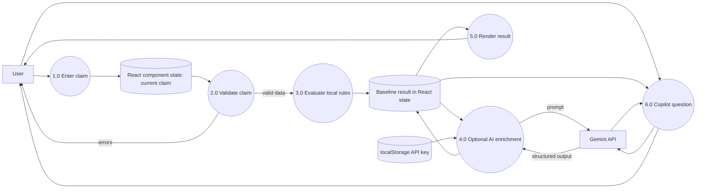
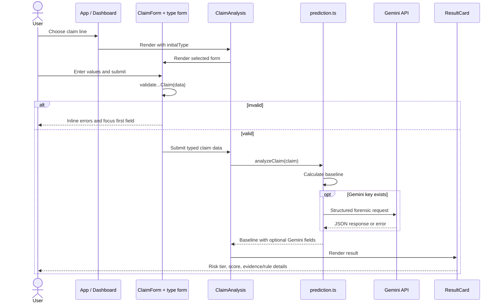
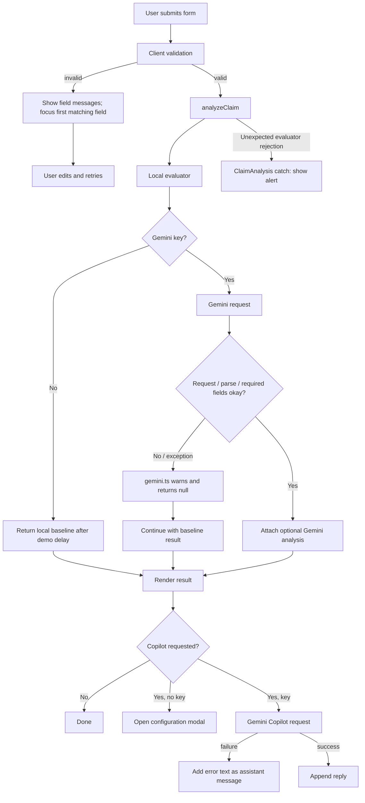

# Veridex: Project Explanation and Technical Study Guide

> This guide describes the checked-in implementation in this repository. It does not treat marketing text or comments as proof of a feature. Source references are relative to the repository root and use line numbers from the inspected files; re-check a line if the source changes.

## 1. Project introduction

Veridex is a single-page React and TypeScript web application for entering sample vehicle or health insurance claim details, running local heuristic checks, and optionally requesting a Gemini-generated forensic narrative. It displays a risk tier, percentage, triggered rule explanations, a claim summary, and—when Gemini is configured—an AI narrative, pattern label, inconsistencies, and SIU checklist. The result is an educational/demo risk signal; the code does not establish fraud as a fact.

### Problem statement

Insurance reviewers need to compare many claim details—dates, policy information, amounts, incident attributes, and evidence indicators. This project demonstrates how a form can collect selected claim attributes, apply transparent threshold rules, and optionally add a natural-language review. It does not connect to insurer records, verify claims against external data, or make a legally binding decision.

### Objectives implemented

- Provide separate claim forms for vehicle and health lines.
- Validate required fields and selected numeric/date constraints in the browser.
- Apply a small, deterministic set of JavaScript heuristic rules and show the rule flags.
- Optionally call Google's Gemini `gemini-2.5-flash` model for structured narrative analysis and interactive Q&A.
- Allow users to load sample claim records and configure/test/clear an API key.
- Display a result summary without persisting claims to a database.

## 2. What is actually present

### Architecture facts

- **Frontend:** React 19, TypeScript, Vite, Tailwind CSS v4, and Lucide icons.
- **Scoring:** synchronous local functions in `src/services/prediction.ts`; no trained model or model artifact is included.
- **AI:** direct browser-side use of `@google/genai` in `src/services/gemini.ts`; the frontend sends a prompt to Google's Gemini API when a key is available.
- **Backend:** no application backend/API server is implemented in `src/`. Express is declared as a dependency but is not imported by the application source. Vite's dev server and Nginx static hosting are serving infrastructure, not a claim-processing backend.
- **Database:** none. Claim forms/results are held in React state. `localStorage` stores the Gemini key only.
- **Authentication/authorization:** none in the app.
- **Network calls:** Gemini generation and the settings modal's connection test. Local heuristic scoring does not require a network call.
- **Deployment configuration:** a Vite build, an Nginx Docker image, and a Vercel SPA rewrite are configured.

### Directory tree (repository files, with generated/vendor folders summarized)

```text
insurance-fraud-detection-system/
├── .dockerignore                 Docker build exclusions
├── .env.example                  Example Gemini and APP_URL values
├── .gitignore                    Git exclusions
├── Dockerfile                    Vite build stage + Nginx runtime stage
├── README.md                     Project overview and setup notes
├── bun.lock                      Bun dependency lockfile
├── index.html                    Browser document shell and metadata
├── metadata.json                 App metadata/capability declaration
├── nginx.conf                    Static hosting and SPA fallback config
├── package.json                  Scripts and dependencies
├── package-lock.json             npm dependency lockfile
├── tsconfig.json                 TypeScript compiler configuration
├── vercel.json                   SPA rewrite rule
├── vite.config.ts                React/Tailwind Vite plugins and asset middleware
├── public/
│   └── assets/aistudio/.gitignore  Asset folder placeholder/ignore file
├── src/
│   ├── App.tsx                    Root navigation and page composition
│   ├── main.tsx                   React DOM bootstrap
│   ├── index.css                  Tailwind CSS import
│   ├── types.ts                   Claim, risk, and result contracts
│   ├── data/sampleData.ts         Initial values and demo presets
│   ├── utils/validation.ts        Client-side claim validators
│   ├── services/
│   │   ├── prediction.ts          Heuristic scoring and optional AI enrichment
│   │   ├── gemini.ts              Gemini structured analysis and Copilot requests
│   │   └── geminiKey.ts           Key lookup, local storage, and update event
│   ├── pages/
│   │   ├── Dashboard.tsx          Landing page and claim entry points
│   │   ├── ClaimAnalysis.tsx      Form/loading/result state controller
│   │   └── About.tsx              System overview and architecture notes
│   └── components/
│       ├── Navbar.tsx             Navigation and Gemini settings trigger
│       ├── Footer.tsx             Static footer
│       ├── ClaimForm.tsx          Car/health selector and form switch
│       ├── CarInsuranceForm.tsx   Vehicle claim inputs and client validation UI
│       ├── HealthInsuranceForm.tsx Health claim inputs and client validation UI
│       ├── LoadingState.tsx       Pending analysis presentation
│       ├── ResultCard.tsx         Risk result and AI output presentation
│       ├── RiskIndicator.tsx      Probability bar and tier legend
│       ├── ClaimSummary.tsx        Result-side claim details
│       ├── GeminiSettingsModal.tsx API-key save/test/clear UI
│       ├── GeminiCopilot.tsx       Interactive per-result AI chat UI
│       └── [other imported icon/UI dependencies]
├── dist/                          Generated Vite output (if built; not source)
├── node_modules/                  Installed packages (not project source)
└── .vercel/                       Local Vercel metadata (not app source)
```

The tree excludes the contents of `node_modules`, `.git`, `dist`, and local deployment metadata because they are generated/vendor data rather than authored application modules. The tracked `public` tree currently contains only the shown `.gitignore`; no claim dataset or model file is present.

## 3. File-by-file purpose and interactions

| File | Role and important connection |
|---|---|
| `src/main.tsx` (1–10) | Finds `#root`, creates a React root, and renders `<App />` under `StrictMode`; imports global CSS. |
| `src/App.tsx` (1–53) | Owns the current page and selected insurance type. Renders Navbar, Dashboard, ClaimAnalysis, About, and Footer. Callbacks change the current page and scroll to the top. |
| `src/pages/Dashboard.tsx` (15–316) | Presents entry points and explanatory capability cards; invokes `onStartAnalysis('car'|'health')`. Capability labels are UI copy, not live claim statistics. |
| `src/pages/ClaimAnalysis.tsx` (9–119) | Holds selected form type, pending state, error, result, and submitted claim. Calls `analyzeClaim`; renders `LoadingState`, `ClaimForm`, or `ResultCard`. |
| `src/components/ClaimForm.tsx` (7–149) | Selects a claim line and mounts one of the two form components. |
| `src/components/CarInsuranceForm.tsx` (17–1004) | Controlled car form. Uses `initialCarClaim`, sample presets, `validateCarInsuranceClaim`, touched/error state, and calls the provided submit callback. |
| `src/components/HealthInsuranceForm.tsx` (15–629) | Controlled health form with the corresponding initial/sample data and health validator. |
| `src/utils/validation.ts` (3–218) | Pure functions return a field-to-message object. They do not call a server or third-party validator. |
| `src/types.ts` (1–116) | TypeScript compile-time schema for claim unions, risk factors, and result payload. Types do not validate runtime data by themselves. |
| `src/data/sampleData.ts` (3–171) | Initial form values and high-/low-risk preset objects; values are demonstration data. |
| `src/services/prediction.ts` (9–298) | Routes a claim to the relevant local heuristic evaluator, optionally appends Gemini output, and returns `PredictionResult`. |
| `src/services/gemini.ts` (1–229) | Serializes claim fields and baseline flags into prompts; uses the Google GenAI SDK for one structured generation and Copilot text generation. |
| `src/services/geminiKey.ts` (1–44) | Reads from browser `localStorage`, then Vite environment values; saves/clears and dispatches `gemini_key_updated`. |
| `src/components/GeminiSettingsModal.tsx` (17–256) | UI around key management and a live `generateContent` connection test. Successful tests save the tested key. |
| `src/components/GeminiCopilot.tsx` (7–247) | Manages the chat drawer, messages, suggested prompts, and request/error states. Delegates network work to `askGeminiCopilot`. |
| `src/components/ResultCard.tsx` (20–323) | Renders the baseline tier/probability/recommendation, optional Gemini summary/pattern/inconsistency/checklist, factors, Copilot and navigation actions. |
| `src/components/RiskIndicator.tsx` (4–84) | Visualizes the probability and labels low/medium/high cutoffs. |
| `src/components/ClaimSummary.tsx` (5–96) | Shows claim reference, timestamp, summary fields, and additional details returned by the scorer. |
| `src/components/LoadingState.tsx` (5–54) | Displays a loading spinner/message selected by coverage type and Gemini key presence. |
| `src/components/Navbar.tsx` (6–196) | Navigation, responsive menu, and key-status indicator; listens for `gemini_key_updated`. |
| `src/components/Footer.tsx` (4–20) | Static branded footer; the displayed “SPEC” string is not a runtime version check. |
| `src/pages/About.tsx` (15–160) | Describes the system and its pipeline. Some prose is explanatory/aspirational; implementation truth is defined by source services. |
| `src/index.css` (1) | Imports Tailwind CSS. |
| `index.html` (1–21) | Vite entry document, meta tags, font links, root element, and `src/main.tsx` script. |
| `vite.config.ts` (1–86) | Configures React and Tailwind Vite plugins, a development asset middleware, alias, env define, and HMR setting. |
| `package.json` (1–36) | Scripts/dependency declarations. `lint` runs `tsc --noEmit`; `clean` uses a Unix shell command and is not cross-platform as written. |
| `tsconfig.json` (1–27) | ES2022/DOM libs, bundler resolution, React JSX, no emit, and Vite types. It does not enable strict mode explicitly. |
| `Dockerfile` (1–20) | Installs dependencies, runs Vite build, then copies `dist` into Nginx. No Node/Express API is started. |
| `nginx.conf` (1–22) | Serves static files, falls back to `index.html` for SPA paths, and adds cache headers for static asset extensions. |
| `vercel.json` (1–8) | Rewrites every route to `/index.html` so the client application loads. |
| `.env.example` | Illustrates `GEMINI_API_KEY` and `APP_URL`; `APP_URL` has no application-code use located. |
| `.dockerignore`, `.gitignore` | Exclude files from Docker context or Git. `.env` patterns are excluded from version control/build context. |
| `metadata.json` | Describes the app, but its `MAJOR_CAPABILITY_SERVER_SIDE_GEMINI_API` claim does not match the inspected client-side Gemini implementation. |
| `README.md` | Setup and feature narrative. Some statements (enterprise/live analytics, “22+” vectors, server-side implications) should not be treated as stronger evidence than source code. |
| `package-lock.json`, `bun.lock` | Lock dependency resolution for npm and Bun, respectively. |

## 4. Technologies: definition, use, alternatives

| Technology | Meaning and where used | Why it fits / alternatives |
|---|---|---|
| TypeScript | JavaScript with static types; used by all `.ts`/`.tsx` application modules and `types.ts`. Vite transpiles it; types are removed before browser execution. | Helps keep the two claim shapes and results consistent. Alternatives: JavaScript with JSDoc, Flow. It is not runtime validation. |
| React 19 | UI library built around components and state. `main.tsx`, `App.tsx`, pages and components use JSX, hooks and props. | Component state suits a multi-step form/result UI. Alternatives: Vue, Svelte, Angular. |
| Vite 6 | Development server and production bundler. `npm run dev` serves, `npm run build` bundles. | Fast feedback and simple static output. Alternatives: webpack, Parcel, esbuild-based custom setup. |
| Tailwind CSS 4 | Utility-first CSS classes used inline in JSX; imported in `src/index.css` and enabled by Vite plugin. | Rapid consistent styling. Alternatives: CSS modules, Sass, vanilla CSS, component style systems. |
| Lucide React | Icon component package imported in UI modules. | Consistent vector icons; alternatives include Heroicons or inline SVG. |
| `@google/genai` | Google GenAI JavaScript SDK. Used in `gemini.ts` and settings connection test to send generation requests. | SDK wraps API request construction. Alternative is direct HTTPS/fetch, preferably from a protected server for secret keys. |
| Browser APIs | `localStorage`, `window`, DOM scroll/focus, clipboard, and timers. Used by key management, forms, result copy, and navigation. | Available without server dependencies. Browser storage is not a secure vault. |
| Node.js/npm | Build/runtime tooling defined by package scripts and Docker's Node build stage. | Ecosystem for Vite/TypeScript. Bun lock exists too. |
| Docker + Nginx | Docker builds static site and Nginx serves it; no API process. | Portable static deployment. Alternatives: static hosting providers, Caddy, Apache. |
| Vercel | `vercel.json` supplies SPA route rewrite. No Vercel SDK/business logic is present. | Simple SPA hosting route support. Alternatives: Nginx static host, Netlify rewrite config. |
| Express, dotenv, Motion, `@types/express`, Node types, esbuild, Autoprefixer | Declared dependencies/dev dependencies. No Express route/server, dotenv loader, or Motion API usage was found in `src/`. | Could support future work, but their package presence alone does not mean they run. Remove only after project owner chooses to clean dependencies. |

**Not present:** Python, a database client, ORM, authentication library, a trained fraud model, scikit-learn, TensorFlow/PyTorch, REST endpoint definitions, or a custom API server. HTML is the `index.html` shell; CSS is generated from Tailwind utilities and its import.

## 5. Application entry and navigation

`index.html` supplies `<div id="root">` and loads `/src/main.tsx` (around lines 17–20). `main.tsx` (1–10) calls `createRoot(...).render(...)`. `<StrictMode>` is a React development aid; it can expose accidental side effects during development and is not a backend or security feature.

`App.tsx` keeps two state values: `currentPage` (`dashboard`, `claim-analysis`, `about`) and `selectedInsuranceType` (`car`, `health`). `handleStartAnalysis` sets both as needed and scrolls to the top. The `key={selectedInsuranceType}` on `ClaimAnalysis` causes React to remount the controller when the selected initial type changes, resetting its internal state. `Navbar` receives callbacks instead of directly owning routing. There is no URL router/history synchronization: navigation is in-memory state; reload returns to the dashboard.

The major path is:

1. Dashboard button calls `onStartAnalysis('car'|'health')`.
2. `App` records the chosen line and renders `ClaimAnalysis`.
3. `ClaimAnalysis` mounts `ClaimForm`, which selects the correct form component.
4. The form validates and invokes the correct submit callback.
5. The page shows a loading view and awaits `analyzeClaim`.
6. It shows `ResultCard` on success; on a thrown error it returns to the form and displays an alert.

## 6. Claim data contracts and form behavior

`src/types.ts` defines `InsuranceType`, `RiskLevel`, `CarInsuranceClaim`, `HealthInsuranceClaim`, the discriminated `ClaimData` union, `RiskFactor`, `GeminiForensicAnalysis`, `PredictionResult`, and generic `ValidationErrors<T>` (lines 1–116). The union `{ type: 'car'; data: CarInsuranceClaim } | { type: 'health'; data: HealthInsuranceClaim }` lets TypeScript narrow claim fields based on `type`.

### Form mechanics

Both form components (Car: lines 22–113; Health: lines 20–95) follow the same shape:

- `formData` stores every field and begins with an initial sample from `sampleData.ts`.
- `errors` stores current validator messages; `touched` records which fields should display errors.
- `handleChange(field, value)` copies state with one changed property. If that field was touched, it revalidates the full object and updates that field's error.
- `handleBlur(field)` marks the field touched and validates the current object.
- `handleSubmit(event)` prevents native navigation, marks all keys touched, validates all values, and calls `onSubmit(formData)` only when no validation errors remain. Otherwise it scrolls/focuses the first matching `id`.
- `loadPreset(preset)` replaces data and clears validation state. `resetForm()` uses explicit defaults (not necessarily the initial populated record) and clears errors/touched.
- The JSX is grouped into Customer, Policy, Incident, Vehicle and Claim sections for car, and Customer, Policy and Claim sections for health. Inputs are controlled: `value` comes from React state and event handlers update it.
- Some numeric fields store `''` while empty and `Number(value)` otherwise. Selects and date inputs store strings. Form validators are manually called; `noValidate` disables browser-native form validation UI.

The forms contain long repetitive markup because each control binds its own label, id, value, event handlers, error display, and options. To understand a field, trace one representative number, one select, and one text input; the repeated pattern is then recognizable. Car sections start at lines 152, 337, 490, 774 and claim submit around 992. Health sections start around lines 134, 307 and 446, with submit around 617. Field labels/IDs are visible near each input.

### Validation rules

`validateCarInsuranceClaim` (`validation.ts:3–125`) builds a partial errors object. It checks required customer fields; age 18–105; tenure 0–700 months; nonblank policy number/city/make/model; nonnegative deductible, premium and component amounts; hour 0–23; at least one vehicle; year 1980 through next calendar year; and total amount greater than zero. It returns all discovered errors instead of throwing.

`validateHealthInsuranceClaim` (`validation.ts:127–218`) checks required identity/demographic fields; age 0–115; nonnegative dependents/premium; effective/expiry dates and expiry not before inception; positive duration and claim amount; required claim/loss dates and claim date not before loss date; and required type/severity/segmentation/status. Date parseability is checked when both relevant dates are present.

These checks are usability validation, not authoritative underwriting or fraud rules. They run only in the client and can be bypassed by a modified browser; there is no server validating submissions.

## 7. Heuristic fraud-risk mechanism

### Dispatch and enrichment

`analyzeClaim` (`prediction.ts:9–34`) first calls `evaluateCarClaim` or `evaluateHealthClaim` based on the discriminant. That produces a complete baseline `PredictionResult`. If `isGeminiConfigured()` is true, it awaits `generateGeminiForensics`; a non-null response is attached as `baseline.geminiAnalysis`. Errors are caught and logged, and baseline scoring is returned. If no key is configured, the function waits 800 ms to simulate brief work. That delay is for UI demonstration, not actual computation. Crucially, Gemini does **not** alter `riskScore`, `fraudProbability`, `riskLevel`, `prediction`, or baseline `recommendation`.

### Vehicle score (actual rules)

`evaluateCarClaim` (`prediction.ts:36–175`) starts at 20 points and adjusts it:

| Condition | Change |
|---|---:|
| total claim / annual premium > 50 | +26, HIGH factor |
| ratio > 25 and <= 50 | +14, MEDIUM factor |
| incident at 23:00–04:00 and no police report | +22, HIGH factor |
| otherwise no police report and authorities value is `None` | +16, MEDIUM factor |
| tenure < 6 months and total claim > $25,000 | +20, HIGH factor |
| otherwise tenure > 60 months | −12, floor 5, LOW loyalty factor |
| `Minor Damage` or `Trivial Damage` and injury claim > $15,000 | +18, HIGH factor |
| at least 2 witnesses and police report available | −10, floor 5, LOW factor |

The score is rounded and clamped to 8–96. Tier mapping is HIGH at 65+, MEDIUM at 35–64, and LOW below 35. The output includes a recommendation string, generated `CAR-year-random-number` reference, ISO timestamp, sample summary, and confidence value. The confidence field is synthesized from a random range (85–96), not calculated statistical confidence.

### Health score (actual rules)

`evaluateHealthClaim` (`prediction.ts:177–297`) starts at 18:

| Condition | Change |
|---|---:|
| loss date 0–14 days after policy effective date | +30, HIGH factor |
| otherwise 15–45 days after effective date | +16, MEDIUM factor |
| claim amount / premium > 40 | +24, HIGH factor |
| segmentation is New Policyholder Watchlist or Tier-1 High Utilization | +18, MEDIUM factor |
| otherwise segmentation is Low Risk Preferred | −12, floor 5, LOW factor |
| severity contains `Mild` and amount > $20,000 | +22, HIGH factor |

It clamps the rounded probability to 9–95 and uses the same 35/65 tier cutoffs. `confidenceScore` is randomly assigned from 88–96, also not calibrated confidence. Returned output includes a `HLT-year-random-number`, timestamp and claim details.

### How to interpret this output

“Probability” here is a hand-authored score converted to a percentage-style display. There is no training set, statistical calibration, precision/recall measurement, or actual probability model in the repository. A rule match indicates only that an input met a coded condition. A LOW label does not prove a claim is legitimate; HIGH does not prove fraud. Factors are only emitted for the listed conditions; absence of a factor is not evidence that the claim is safe.

## 8. Gemini integration in detail

### Key lookup and UI

`geminiKey.ts:4–25` checks local storage key `insurance_fraud_gemini_api_key`, then `import.meta.env.VITE_GEMINI_API_KEY`, then `import.meta.env.GEMINI_API_KEY`, returning an empty string if none is available. `saveGeminiApiKey` and `clearGeminiApiKey` write/remove the local-storage value and dispatch `gemini_key_updated` (`:27–40`). `isGeminiConfigured` is a nonempty-key check (`:42–44`), not a validation of whether the key works.

`GeminiSettingsModal.tsx:22–95` initializes the field when opened, tests connection by making a real generation request, saves a successful test key, and can save/clear. `Navbar.tsx` listens to the update event to refresh its active/configured label. A UI “configured” status therefore means a string key is present; only “Test Connection” checks the remote API.

### Forensic generation

`generateGeminiForensics` (`gemini.ts:11–180`):

1. Reads a key; returns `null` if absent.
2. Creates `new GoogleGenAI({ apiKey })` in the browser.
3. Builds a type-specific plain JavaScript object containing selected customer, policy, incident, vehicle and financial fields (car lines 23–76; health lines 77–100).
4. Interpolates JSON and heuristic tier/probability/rule flags into a prompt (about lines 102–117).
5. Calls `ai.models.generateContent` with model `gemini-2.5-flash`, the prompt, JSON MIME type, a `Type.OBJECT` schema, required properties, and `temperature: 0.2` (about lines 119–166).
6. Parses `response.text` with `JSON.parse`. If summary or pattern is missing, returns `null`; optional lists default to empty arrays and action defaults to baseline recommendation.
7. Returns a `GeminiForensicAnalysis` with the model name. Any caught issue logs a warning and returns `null` (about lines 168–180).

The schema requests `executiveSummary`, `fraudPattern`, `inconsistencies`, `siuChecklist`, and `recommendedAction`. In `ResultCard.tsx`, the screen displays the first four, but the component does not read/render `geminiAnalysis.recommendedAction`; the visible adjudication directive remains the local baseline `recommendation`.

### Copilot communication

`askGeminiCopilot` (`gemini.ts:183–229`) requires a key or throws. It builds context from claim type, baseline score/tier, compact summary, rule titles, and `JSON.stringify(claim.data)`. It sends that as a user message, a fixed assistant acknowledgment as a model message, then mapped prior chat history, then the new question. It calls the same model with `temperature: 0.4` and returns `response.text` or a fallback string. There is no persistent server-side conversation; `GeminiCopilot.tsx` keeps messages in component state for the mounted result screen.

### Gemini concepts in simple terms

- **Generative AI:** software that produces new text/content from an input. Here Gemini produces a narrative and suggested investigation questions.
- **LLM:** a model trained on large text corpora that predicts token sequences. It can generate plausible but incorrect statements; it does not verify claim facts by itself.
- **Prompt engineering:** structuring instructions and input context. This project supplies role text, claim JSON, baseline signals, numbered evaluation criteria, and a structured response schema.
- **API:** a programmatic interface to a remote service. The SDK sends HTTPS requests to Google's API; the repository does not define its own REST endpoint.
- **JSON:** key/value and array serialization. Claim details are stringified in prompts; the structured forensic response is requested as JSON and parsed.
- **Temperature:** generation setting affecting variability. `0.2` is used for structured forensic output; `0.4` for Copilot. It does not make an answer factually reliable.

Gemini integration is not model training. Training changes model weights using examples and compute; this code calls an already trained hosted model at inference time. No weights, training loop, labels, or evaluation pipeline are included.

## 9. End-to-end lifecycle and data flow

1. Browser loads `index.html`; Vite-built JS mounts React.
2. `App` displays Dashboard and Navbar.
3. The user selects vehicle or health analysis. `ClaimForm` mounts the corresponding form using defaults from `sampleData.ts`.
4. User edits controlled fields. Change/blur events update React state and run client validation for touched fields.
5. Submit validates the entire claim. Invalid input stays in the form, shows errors, and scrolls/focuses the first field whose ID matches the validation key.
6. Valid data is wrapped as `{type, data}` and passed to `ClaimAnalysis`.
7. `ClaimAnalysis` sets loading state, records the claim in component state, and awaits `analyzeClaim`.
8. A local evaluator calculates a baseline from the values and returns tier, percentage, recommendation, factors, confidence-like display value, reference, timestamp, and summary.
9. If a Gemini key exists, the browser sends selected claim fields plus baseline facts to Google Gemini. Structured output is parsed; invalid/missing critical output or API errors yield no AI enrichment, so the baseline is retained.
10. On success, `ResultCard` renders the baseline and optional AI fields. A Copilot can make subsequent independent Gemini requests. There is no storage of the claim after component state is discarded.
11. On thrown analysis error, `ClaimAnalysis` displays an alert and lets the user submit again. Gemini forensic errors are intentionally swallowed by service code, so they generally result in baseline-only output rather than a page error. Copilot errors become a chat message.

## 10. Mermaid diagrams (reflecting implemented components only)

### A. Overall architecture



### B. Application workflow



### C. Gemini API communication



### D. Fraud scoring flow



### E. DFD Level 0 (context)



### E. DFD Level 1



### F. Sequence diagram (whole result path)



The sequence contains no backend or database participant because neither exists. The Copilot interaction is shown in diagram C and architecture diagram A.

### G. Error handling



“Missing information” is mostly a client validator concern. Gemini schema validation is limited: a valid JSON parse and truthy summary/pattern are required, while other fields default. The code does not comprehensively validate response field types or array members at runtime.

## 11. Important code snippets and reading notes

### Claim type dispatch (`src/services/prediction.ts`, lines 9–34)

```ts
if (claimData.type === 'car') {
  baseline = evaluateCarClaim(claimData.data);
} else {
  baseline = evaluateHealthClaim(claimData.data);
}
```

The `type` discriminator chooses the compatible field schema and algorithm. This is local function dispatch, not an HTTP route. The returned baseline object is then optionally enriched with Gemini output.

### Risk cutoff (`src/services/prediction.ts`, around lines 126–143 and 265–282)

```ts
if (finalProbability >= 65) riskLevel = 'HIGH';
else if (finalProbability >= 35) riskLevel = 'MEDIUM';
else riskLevel = 'LOW';
```

The same boundaries are used by `RiskIndicator.tsx` (roughly lines 61–75). Dashboard guidance should stay synchronized with those thresholds.

### Optional Gemini enrichment (`prediction.ts`, lines 21–30)

```ts
const geminiForensics = await generateGeminiForensics(claimData, baseline);
if (geminiForensics) baseline.geminiAnalysis = geminiForensics;
```

Only the optional property changes. The score is computed first and left intact, which is why the final classification is the heuristic classification even when AI provides a narrative.

### Important UI functions and state, module by module

This is a function-level map for the remaining UI modules. JSX inside the large form files is mostly repeated field wiring; the sections explain what each group is doing, while each field's exact key and validation constraint is defined in `types.ts` and `validation.ts`.

| Module/function | Inputs/state | Work and output |
|---|---|---|
| `App` (`App.tsx:9–53`) | `currentPage`, `selectedInsuranceType` | `handleStartAnalysis(type)` saves the selected type and switches page; `handleNavigate(page)` switches among dashboard/claim analysis/about. Both scroll the window to top. The returned JSX passes callbacks down and conditionally mounts the page. |
| `Dashboard` (`Dashboard.tsx:15–316`) | `onStartAnalysis`, `onNavigateToAbout`; local constant `stats` | Static capability/coverage content and buttons. `stats` are hardcoded labels/values, not fetched telemetry. The car/health actions call the supplied callback; the system-spec action calls the other callback. |
| `ClaimAnalysis` (`ClaimAnalysis.tsx:14–119`) | `initialType`, `onBackToDashboard`; six state values | `handleSubmitCarClaim` and `handleSubmitHealthClaim` guard duplicate submits, clear old error/result, set loading, wrap payload with the matching discriminator, await `analyzeClaim`, store result or display an alert, and reset loading in `finally`. `handleAnalyzeAnother` clears result/claim/error and returns to the form. Render conditions ensure form, loader, and result do not display as competing states. |
| `ClaimForm` (`ClaimForm.tsx:15–149`) | current type, selection callback, two submit callbacks | It does not own claim-field data. It renders two radio-like buttons and conditionally mounts `CarInsuranceForm` or `HealthInsuranceForm`, passing the matching submit callback. |
| `CarInsuranceForm` (`CarInsuranceForm.tsx:22–1004`) | submit callback; formData/errors/touched state | `handleChange` updates one key; `handleBlur` marks it touched; `handleSubmit` validates all and either submits or focuses the first invalid field; `loadPreset` replaces all fields; `resetForm` restores explicit blank/default values. Form sections group customer, policy, incident, vehicle, and financial claim data. |
| `HealthInsuranceForm` (`HealthInsuranceForm.tsx:20–629`) | same state pattern for health schema | Same validation lifecycle as car form, with customer, policy and claim sections. `loadPreset` selects high/low examples; reset clears fields to defaults. |
| `ResultCard.getHeaderTheme` (`ResultCard.tsx:38–66`) | a `RiskLevel` | Returns presentation class names and an icon for HIGH/MEDIUM/LOW; it does not calculate the level. `handleCopyQuestion` (`:68–73`) calls the browser clipboard API for an SIU checklist item and briefly changes its icon. The JSX conditionally renders Gemini sections, risk factors, Copilot, summary and navigation. |
| `RiskIndicator.getTheme` (`RiskIndicator.tsx:15–36`) | `riskLevel` | Returns text/bar color classes. The component takes `fraudProbability`, clamps the visual width to 2–100%, and displays the same 35/65 legend boundaries. It visualizes a number; it does not score claims. |
| `ClaimSummary` (`ClaimSummary.tsx:9–96`) | `PredictionResult` | Destructures summary/reference/timestamp and maps `additionalDetails` into display rows. `toLocaleDateString` formats the result timestamp using browser locale settings. |
| `LoadingState` (`LoadingState.tsx:9–54`) | `insuranceType`; reads `isGeminiConfigured()` | Shows a CSS spinner and explanatory state text. The current implementation does not measure actual scoring stages or percentage completion. |
| `Navbar` (`Navbar.tsx:11–196`) | current page and callback; menu/modal/key status state | `useEffect` subscribes to `gemini_key_updated` and cleans up its listener. `handleNav` changes page and closes mobile menu. `navItems` is static. The status is based on key presence, not a fresh remote health check. |
| `GeminiSettingsModal` (`GeminiSettingsModal.tsx:22–256`) | open/close props; input/saved/env/test/error state | An effect fills input from key utility when opened. `handleSave` stores a key (blank clears it); `handleClear` removes local storage; `handleTestConnection` sends a real small generation prompt, marks success and saves the tested key, or stores an error. |
| `GeminiCopilot` (`GeminiCopilot.tsx:20–247`) | claim, baseline result, settings callback; messages/input/loading/open state | `useEffect` scrolls the message list when open/messages change. `handleSend` rejects empty/duplicate sends, opens settings if no key, appends the user message, maps prior messages to SDK roles, calls `askGeminiCopilot`, and appends reply/error. Quick prompts call the same function. |
| `Footer` (`Footer.tsx:4–20`) | none | Returns static text/logo; there is no dynamic status lookup. |
| `About` (`About.tsx:15–160`) | none; local `processSteps` list | Maps a static four-stage explanatory list into cards, then presents demo disclaimer and architecture narrative. It is informational content, not the execution pipeline itself. |

### Which form fields affect the deterministic score?

Many collected fields are displayed in the claim summary or sent as Gemini context, but are not read in the local risk equations. This difference matters in a viva:

- **Car rule inputs:** `totalClaimAmount`, `annualPremium`, `monthsAsCustomer`, `incidentHour`, `policeReportAvailable`, `authoritiesContacted`, `incidentSeverity`, `injuryClaim`, and `witnesses`. Most other car fields are currently descriptive/display or prompt context only.
- **Health rule inputs:** `policyEffectiveDate`, `lossDate`, `claimAmount`, `premiumAmount`, `riskSegmentation`, and `incidentSeverity`. `numberOfDependents` is copied into result summary but is not used to adjust the risk score. Fields such as plan type, employment, claim status and claim filing date are not part of the local score rules, although some are sent to Gemini.

The validators likewise check more fields than the heuristic evaluator uses. Validation says an input is acceptable for this form; it does not mean the field has scoring weight.

## 12. Concepts requested for evaluation

| Concept | Plain and technical definition | Example here |
|---|---|---|
| Client/server architecture | Client is the browser UI; server is a process offering resources/services. | React app is client. Gemini is a remote provider. This repo has no business-logic backend. |
| REST API | A web API style exposing resources and HTTP methods/URLs. | No project-owned REST endpoint exists. Gemini SDK calls Google's API; do not describe this as a Veridex REST API. |
| HTTP methods | GET reads, POST submits, etc. | Source calls SDK `generateContent`; no application code explicitly implements GET/POST routes. Underlying SDK performs network communication. |
| JSON | Portable structured text format. | Claim subsets are `JSON.stringify`-encoded into Gemini prompt; structured reply is parsed using `JSON.parse`. |
| Environment variable | Deployment-time process/config value. | Vite exposes `VITE_GEMINI_API_KEY`; `vite.config.ts` also defines `process.env.GEMINI_API_KEY` from build process. Client build values are not secret. |
| API authentication | Credential attached to a service request. | Gemini SDK receives `{ apiKey }`; the key is used from browser local storage or build-time config. There is no user login. |
| Asynchronous programming | Promise-based work that doesn't block the UI thread while awaiting completion. | Submit handlers await `analyzeClaim`; Gemini methods await `generateContent`; loading state is rendered meanwhile. |
| Validation | Checking input shape/rules before processing. | Pure field validators run in browser on blur/change/submit. No server-side validation. |
| Exception handling | `try/catch/finally` recovers from thrown errors and guarantees cleanup. | `ClaimAnalysis` clears loading in `finally`; Gemini forensic catch returns `null`; Copilot catches and displays an error message. |
| Prompt engineering | Constructing instructions/context/output format for a model. | Role, claim JSON, baseline flags, numbered criteria, JSON response schema. |
| Risk classification | Mapping a score/range to labels. | `<35 LOW`, `35–64 MEDIUM`, `>=65 HIGH`; this is a hand-coded rule threshold. |
| Data processing | Transforming input into useful outputs. | Form values -> claim union -> numeric conversions/rules -> result fields. |
| Database operations | Persistent CRUD against a database. | None implemented. React state is temporary and localStorage stores only the key. |
| Single-page application (SPA) | One HTML shell updated by client-side code. | React swaps pages with state; Nginx/Vercel route all paths to `index.html`. |

## 13. Requirements and setup

### Software requirements from project configuration

- Node.js compatible with `node:20-alpine` for the documented Docker build; npm is used in the Dockerfile and README. The package scripts require a compatible Node environment.
- A modern browser with JavaScript, DOM, and `localStorage` enabled.
- Optional Gemini API key and network access for Gemini generation/testing.
- Docker only if using the included container flow; Nginx is supplied by the image.

### Hardware

There are no specialized hardware requirements or local ML/GPU requirements. Any supported computer capable of running a modern browser and Node build environment is sufficient for the web demo. No benchmarks, minimum CPU/RAM values, or production capacity are declared by the implementation.

### Run commands (from `package.json`)

- `npm run dev`: Vite on port 3000, host `0.0.0.0`.
- `npm run build`: create static production output in `dist/`.
- `npm run preview`: preview Vite production output.
- `npm run lint`: TypeScript no-emit check (despite the name, it invokes `tsc --noEmit`, not ESLint).
- Docker: `docker build -t veridex .`; `docker run -p 3000:80 veridex`.

`README.md` describes optional key configuration using `VITE_GEMINI_API_KEY`; `.env.example` instead shows `GEMINI_API_KEY` and `APP_URL`. The key utility reads `import.meta.env.GEMINI_API_KEY`, while `vite.config.ts` defines `process.env.GEMINI_API_KEY`; these are different expressions, and the utility does not read `process.env`. Vite does not expose arbitrary unprefixed environment values through `import.meta.env` by default. Therefore the `GEMINI_API_KEY` fallback may not work as `.env.example` implies; `VITE_GEMINI_API_KEY` is the conventional Vite client variable, but it is bundled into browser code and is not secret. Do not assume `.env.example` is automatically loaded: the repository has `dotenv` installed but does not import/configure it in the app. The most reliable way to confirm a deployment's behavior is to inspect the actual build environment and test the key in the UI.

## 14. Advantages

- The baseline rules are easy to inspect and explain; the factors expose which implemented thresholds fired.
- Car/health claim shapes are explicitly typed and separate.
- The app remains usable for heuristic scoring without a Gemini key.
- The AI response requests a constrained JSON structure rather than free text alone.
- Sample records make the demo reproducible at the UI level (the displayed random reference/confidence still vary).
- Static SPA deployment is straightforward through Nginx or Vercel.

## 15. Limitations, incomplete features, and risks (identified; not changed)

### Functional/model limitations

1. **No trained ML model.** The scorer is a few hand-authored if-statements. There is no dataset ingestion, training, model file, or model evaluation.
2. **No ground-truth probability.** Hand-added points are presented as percent-like “fraud probability”; the UI calls a separately randomized number “confidence.” Neither is statistically calibrated.
3. **No real operational data.** Dashboard numbers/capabilities and presets are static UI/sample content; there is no insurer telemetry feed or claims history store.
4. **Gemini is advisory text only.** It does not change local risk tier/score. `recommendedAction` from Gemini is parsed but not shown in `ResultCard`.
5. **No database or authentication.** Claims are not persisted, users cannot sign in, and no access control or audit trail exists.
6. **No provider-independent fallback queue/retry.** Forensic generation failure returns baseline; Copilot shows an error message. There is no retry/backoff or request cancellation.
7. **No runtime response schema validator.** SDK schema requests JSON, but parsed data is cast to `Partial<...>` and checked mainly for summary/pattern presence.
8. **Potential rule/data edge cases:** car annual premium and health premium may be zero under validation; the scorer substitutes 1 in the denominator (`Number(...) || 1`), which can produce extreme ratios. Health rule date arithmetic relies on browser date parsing. Form validation is client-only and can be bypassed.
9. **Random output fields:** reference suffix and `confidenceScore` use `Math.random`; they do not represent unique persistent database IDs or measured confidence.
10. **The names “fraud detection” and “probability” can overstate what the demo proves.** Human review and external evidence remain necessary in a real setting.

### Security/privacy concerns

1. **Browser API key exposure:** keys entered in the modal are stored unencrypted in `localStorage`; any same-origin script with execution access could read them. A Vite environment key embedded in the bundle is also visible to users. There is no server-side secret boundary.
2. **Sensitive data disclosure:** Gemini prompts include direct claim fields such as policy/customer identifiers, demographic details, policy and incident data. The source does not redact or minimize those fields before sending them.
3. **No authentication or authorization:** anyone who can access the app can use any client-configured capability. No server controls exist.
4. **No privacy notice/consent flow or retention policy** is implemented in the source. No data retention database is present, but data is sent to Gemini when enabled.
5. **Prompt injection/data trust:** user-controlled claim strings are embedded in an LLM prompt. The prompt gives a role/instructions but the code does not isolate untrusted text in a formal security boundary or validate the answer as fact.
6. **External link:** the API-key help link opens Google AI Studio in a new tab with `noopener noreferrer`, which is an appropriate tab isolation measure.

### Repository/documentation mismatches

- README branding calls this “enterprise-grade” and describes production-like feature coverage; source has a local heuristic demo, no claims DB, no authentication, and no server API.
- `metadata.json` says `MAJOR_CAPABILITY_SERVER_SIDE_GEMINI_API`; actual Google SDK calls are from browser modules.
- README says “22+” and “18+” vectors; visible forms expose many fields, but the deterministic scorer uses only a subset of those inputs. Number of form fields is not number of scoring rules.
- `src/pages/About.tsx` describes future backend integration, and its architecture drawing is explanatory, not an implemented server pipeline.
- `express`, `dotenv`, and `motion` are present in package metadata but no source usage was found.

## 16. Future scope (not currently implemented)

- Add a server API so the Gemini key is never delivered to the browser; protect it with server auth, quotas, rate limits, logging controls, and secret management.
- Add consent, data minimization/redaction, retention rules, encryption, and audit trails appropriate to insurance/health data.
- Validate again on the server and define explicit request/response schemas.
- Store authorized claims and decisions in a database with role-based access and traceable reviewer actions.
- Train/evaluate a model only with lawful, representative, labeled data; report calibration, false-positive/false-negative tradeoffs, bias checks, and drift.
- Treat AI analysis as a cited, reviewable recommendation; show Gemini's recommended action or remove it from the schema, and avoid presenting unsupported confidence/probability.
- Add accessible routing, keyboard behavior, loading cancellation, retries, and integration tests.

## 17. Conclusion

Veridex is best presented as a client-side educational prototype that combines transparent, fixed heuristic rules with optional Gemini-generated analysis. Its strongest implementation concept is hybrid enrichment with graceful baseline fallback. Its key boundary is that the local score remains the final displayed classification; Gemini provides narrative assistance. It should not be presented as a trained fraud model, a live insurer system, or a secure production handling path for real personal/medical data.

## 18. Two-minute oral explanation

“My project is Veridex, a browser-based insurance claim risk assessment demo for vehicle and health claims. It is built with React, TypeScript, Vite, and Tailwind. A user enters claim and policy details in a controlled form. The form checks required fields, numeric ranges, and selected date rules in the browser. When valid, the claim is passed to a local service that applies a set of explicit heuristic rules—for example, claim-to-premium ratios, policy inception timing, police-report availability, tenure, and severity inconsistencies. Those rules add or subtract points, clamp a score to a percentage-style range, and map it to LOW, MEDIUM, or HIGH.

If a Gemini API key is configured, the app sends selected claim data and the baseline rule flags directly from the browser to Google Gemini 2.5 Flash. Gemini is asked to return structured JSON with a narrative, a pattern label, inconsistencies, and SIU checklist questions. The app parses that answer and attaches it to the result. If Gemini is missing or fails, the local heuristic result still appears. Gemini does not change the score or tier. The result page shows the tier, score, triggered rule factors, a claim summary, and optional AI findings. There is no custom backend, database, authentication, or trained ML model, so this is a prototype and its percentages are not calibrated fraud probabilities. In a real system I would move API access to a protected backend, validate on the server, protect personal data, and evaluate any scoring model on representative labeled data.”

## 19. Five-minute project presentation script

### Opening and problem (about 40 seconds)

“I built Veridex to demonstrate how an insurance reviewer could examine claim details using clear risk rules and optional AI assistance. Fraud investigations often involve checking consistency across policy dates, claimed amounts, incident circumstances, and evidence. This prototype demonstrates those checks in a user interface. It is an educational decision-support demo, not an operational fraud verdict system.”

### Architecture and technologies (about 50 seconds)

“The frontend is a React single-page application written in TypeScript. Vite starts the development server and bundles production files, Tailwind styles the interface, and Lucide supplies icons. `main.tsx` mounts `App`. `App` owns the page and selected claim line. The Dashboard starts a vehicle or health analysis; `ClaimAnalysis` controls form, loading, error, and result states. There is no project backend or database. Docker builds the frontend and serves static files using Nginx.”

### Input and validation (about 55 seconds)

“The user selects vehicle or health and fills a controlled form. React state is the source of truth for inputs. On blur and after a field has been touched, the form uses a pure validation function. On submit, it checks all fields. For example, car age must be 18 to 105, incident hour 0 to 23, vehicle year within a supported range, and claim amount positive. The health form also checks date ordering. If a form is invalid, it displays field-level errors and focuses the first invalid field. These are client-side checks, so a production service would repeat validation on its server.”

### Scoring and AI (about 90 seconds)

“The valid claim is wrapped in a discriminated object with either `type: car` or `type: health`. `analyzeClaim` chooses the matching evaluator. The car evaluator begins at 20 points and applies five rule groups; the health evaluator begins at 18 and applies four groups. Rules add or subtract points and record a title, description, and impact. The rounded result is clamped and mapped to LOW, MEDIUM, or HIGH using 35 and 65 cutoffs. This is rule-based scoring, not a trained machine-learning model, and the percentage is not statistically calibrated.

“When a Gemini key exists, the browser SDK sends selected claim fields and the baseline score and flags to Gemini 2.5 Flash. The request asks for a JSON schema. The code parses the response and checks that a summary and fraud pattern exist. On API failure, forensic generation returns null and the baseline remains available. Gemini output adds text; it does not update the risk tier or score. An additional Copilot can send follow-up questions with claim context.”

### Results, limitations and close (about 55 seconds)

“The result view displays the baseline recommendation, probability bar, rule factors, and claim summary, with AI narrative and checklist when available. The API key is currently stored in browser localStorage or can be supplied through a Vite build variable, so this is not appropriate for real secrets or sensitive claims. There is no authentication, database, or audit history. My next production steps would be a protected server integration, privacy controls, server validation, and proper model evaluation. The main value of this project is demonstrating the end-to-end UI and the boundary between transparent rules and generative-AI assistance.”

## 20. Complete end-to-end explanation (quick recall)

`index.html` -> `main.tsx` -> `App` -> Dashboard -> choose claim type -> `ClaimForm` -> car/health controlled form -> validator -> typed claim object -> `ClaimAnalysis` loading state -> `analyzeClaim` -> local evaluator creates baseline -> optional Gemini request and structured parse -> baseline with optional `geminiAnalysis` -> `ResultCard` -> optional Copilot follow-up. Invalid forms never reach scoring. Gemini forensic failure falls back to baseline. No application database or server receives/stores claims.

## 21. Twenty most important viva questions

1. **What is Veridex?** A browser-based demo that scores vehicle/health claims using explicit rules and optionally adds Gemini text analysis.
2. **What problem does it address?** It demonstrates a structured way to review selected claim details and surface rule-triggered inconsistencies.
3. **What is its architecture?** React SPA, client validators, local TypeScript scoring, optional direct Gemini API calls, and result UI.
4. **Is there a backend?** No custom claim-processing server is present; Gemini calls happen from browser code.
5. **Is there a database?** No. Claim and result state is transient React state; only the API key is stored in localStorage.
6. **Is this machine learning?** The fraud scoring is not. It is fixed rule-based logic; Gemini is a pretrained hosted generative model used for text analysis.
7. **How are claims classified?** Score below 35 is LOW, 35–64 MEDIUM, and 65 or above HIGH after clamping.
8. **How does a car claim get scored?** The evaluator starts at 20, checks ratio, late incident/report, tenure, injury/severity, and witnesses/report conditions, then clamps/maps the result.
9. **How does a health claim get scored?** It starts at 18, checking policy inception proximity, claim/premium ratio, selected segmentation, and mild-severity/high-cost conditions.
10. **What does Gemini do?** It returns a structured narrative, scheme label, inconsistencies, and checklist when configured.
11. **Does Gemini decide the tier?** No. It is attached after baseline calculation and does not modify the baseline score/tier.
12. **Which model is called?** `gemini-2.5-flash` in `src/services/gemini.ts`.
13. **How is the prompt built?** The code serializes selected claim details and includes baseline risk tier, percentage, rule flags, evaluation instructions, and a JSON response schema.
14. **What if Gemini fails?** Forensic generation catches the failure and returns null, so baseline scoring is shown. Copilot displays an error in the chat.
15. **How is input validated?** Pure TypeScript functions return field errors; form submit validates all fields before invoking the scoring page callback.
16. **How is the API key stored?** It prefers localStorage, then Vite env values. Local storage is readable by same-origin JavaScript, so this is not secure secret storage.
17. **What does “confidence” mean here?** The field is randomly generated in a range; it is not model confidence or a calibrated metric.
18. **What is the main limitation?** The rules are hand-authored and unvalidated against a real labeled dataset; outputs are demonstrative, not proof of fraud.
19. **What would you improve for production?** Protected server API, authentication/authorization, server validation, privacy controls, audit persistence, and rigorous model/rule evaluation.
20. **What happens if no key is present?** The local rules still run; the service adds a short demo delay and returns the baseline result.

## Appendix: source line index

Use this as a starting map, not a substitute for reading the full source. Exact important declarations are listed in the file-by-file table above.

- App state/navigation: `src/App.tsx:8–27`
- Scoring dispatch: `src/services/prediction.ts:9–34`
- Car evaluator: `src/services/prediction.ts:36–175`
- Health evaluator: `src/services/prediction.ts:177–297`
- Gemini forensic prompt/schema: `src/services/gemini.ts:11–180`
- Gemini Copilot prompt/history: `src/services/gemini.ts:183–229`
- Key utility: `src/services/geminiKey.ts:1–44`
- Car validator: `src/utils/validation.ts:3–125`
- Health validator: `src/utils/validation.ts:127–218`
- Form submit/preset/reset pattern: car `src/components/CarInsuranceForm.tsx:27–113`; health `src/components/HealthInsuranceForm.tsx:25–95`
- Claim state/error/loading: `src/pages/ClaimAnalysis.tsx:14–119`
- Result rendering: `src/components/ResultCard.tsx:28–323`
- Deployment: `Dockerfile:1–20`, `nginx.conf:1–22`, `vercel.json:1–8`
